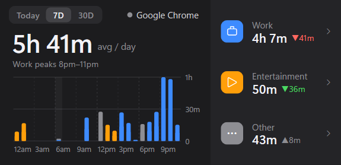

# Screen Time Widget

A tiny, private screen-time widget for Windows 11. It shows **where your laptop time actually goes**: how much is work and how much is entertainment, and **at what time of day** you're most productive.



- **Native and tiny**: a single ~0.5 MB `.exe` written in Rust against the Win32 API. Uses about 8–16 MB of RAM and about 0% CPU. No Electron, no web view, no runtime.
- **100% local**: no account, no server, no telemetry. Your data stays in a folder on your own disk.
- **Apps and websites**: tracks the app in front (VS Code, Discord…) and, with the small Chrome extension, the exact website (github.com, youtube.com…).
- **Your own categories**: put any app or site into Work, Entertainment, or anything you like. Everything else goes to *Other*.

## Features

| | |
|---|---|
| **Today / 7D / 30D** | Today's total, or your average per day over the last 7 or 30 days. |
| **Hour-of-day chart** | 24 bars stacked by category. In 7D/30D each bar is your *average* for that hour, so patterns like "I work most at night" jump out. |
| **Insights** | "Work peaks 8pm–11pm", or for today "Work ▲ 40m vs usual by now". |
| **Trends** | Each category shows ▲/▼ vs the previous 7/30 days: green when it moves the way you want (more Work, less Entertainment). |
| **Breakdown** | Click a category to slide in every app and site inside it, with real logos. Scroll with the mouse wheel. |
| **Smart idle detection** | Stops counting 2 minutes after you walk away, but keeps counting while a video plays: in any Chrome tab (YouTube, Drive…) or any app playing sound (VLC, a Zoom call…). Games can require input. |
| **Widget behaviour** | Drag to move. Right-click for *Always on top*, *Lock position*, *Start with Windows*, *Edit categories*, *Exit*. |

## Install

### 1. Build the widget

You need [Rust](https://rustup.rs). Any Windows toolchain works. If you don't have Visual Studio installed, use the GNU toolchain, which needs nothing else:

```sh
rustup toolchain install stable-x86_64-pc-windows-gnu
rustup default stable-x86_64-pc-windows-gnu
git clone https://github.com/arhamimran-bit/Screen-Time-Widget-.git
cd Screen-Time-Widget-
cargo build --release
```

Run `target\release\ScreenTimeWidget.exe`. The widget appears in the top-right corner. Right-click it and enable **Start with Windows** so it keeps tracking after a restart.

> Keep the project folder where it is: your data is stored in its `data\` folder (see below).

### 2. Install the Chrome extension (for website tracking)

1. Open `chrome://extensions` and turn on **Developer mode** (top right).
2. Click **Load unpacked** and select the `extension` folder of this project.
3. Using several Chrome profiles? Repeat this in each profile. Tracking is by website, not by profile.

Without the extension, all browser time shows up as "Google Chrome". The extension only talks to the widget on `127.0.0.1` (your own machine). Edge and Brave can load the same extension, but only `chrome.exe` is mapped to it right now.

## Categories: add, change or remove

Right-click the widget and choose **Edit categories (config.json)**, or open `data\config.json` in any editor. Save the file and the widget reloads it within a few seconds; no restart needed.

```jsonc
{
  "day_starts_at_hour": 0,            // 0 = the day resets at midnight
  "categories": [
    {
      "name": "Work",
      "color": "#3D8BFF",
      "icon": "",               // a glyph from the "Segoe Fluent Icons" font
      "goal": "more",                 // "more" | "less" | "": colours the trend arrows
      "idle_secs": 120,               // stop counting after 2 min without keyboard/mouse
      "count_while_video_plays": true, // ...unless a video/audio is playing
      "apps": [
        { "name": "VS Code", "exe": "Code.exe" }
      ],
      "sites": [
        { "name": "GitHub", "domain": "github.com" },
        { "name": "Play Console", "domain": "play.google.com/console" }
      ]
    }
  ],
  "other": { "name": "Other", "color": "#8E8E93", "icon": "", "idle_secs": 120 }
}
```
*(`//` comments are only for this explanation; JSON files can't contain them.)*

- **Add an app**: add `{ "name": "Discord", "exe": "Discord.exe" }` to `apps`. The exe name is shown in Task Manager → *Details*.
- **Add a website**: add `{ "name": "Notion", "domain": "notion.so" }` to `sites`. Subdomains are included (`youtube.com` also matches `m.youtube.com`).
- **Only part of a site**: add a path, for example `play.google.com/console`. The most specific rule wins.
- **Remove**: delete the line. That app or site's past time moves to *Other*; nothing is deleted.
- **New category**: copy a whole category block and give it a new name and colour.
- **Per-item rules**: any app or site can override `idle_secs` and `count_while_video_plays`. A browser game can use `"idle_secs": 60, "count_while_video_plays": false`, so it only counts while you're actually playing (game sound alone doesn't count).

Categories are applied when the widget draws, so changing them also re-sorts your past history.

## Your data

Everything lives in the project's `data\` folder, which is git-ignored, so it is never committed:

| File | What |
|---|---|
| `data\config.json` | Your categories (created from `config.default.json` on first run) |
| `data\days\YYYY-MM-DD.json` | One small file per day: seconds per app/site, plus seconds per hour |
| `data\settings.json` | Widget position and toggles |
| `data\icons\`, `data\apps.json` | Cached site logos and where app logos come from |

Back up the `data\` folder if you reinstall Windows.

## How it works

Every second the widget asks Windows which window is in front (`GetForegroundWindow`), which `.exe` owns it, and how long ago you last touched the keyboard or mouse (`GetLastInputInfo`). For Chrome, it uses the site that the extension reported. It then looks the app or site up in your categories and adds a second to today's file. Drawing is done with Direct2D and DirectWrite.

A longer beginner-friendly explanation is in [docs/HOW_IT_WORKS.md](docs/HOW_IT_WORKS.md).

## Project layout

```
src/
  main.rs       entry point: single instance, DPI awareness, start server + UI
  ui.rs         window, message loop, mouse, animations, all drawing
  tracker.rs    which app/site is in front, idle detection
  config.rs     categories and matching rules
  storage.rs    one JSON file per day
  icons.rs      app logos (Windows shell) and site favicons
  server.rs     tiny localhost HTTP listener for the extension
  dates.rs, settings.rs, autostart.rs, util.rs
extension/      Chrome extension (Manifest V3, plain JS)
```

## License

[MIT](LICENSE): free to use, copy, modify and share.
